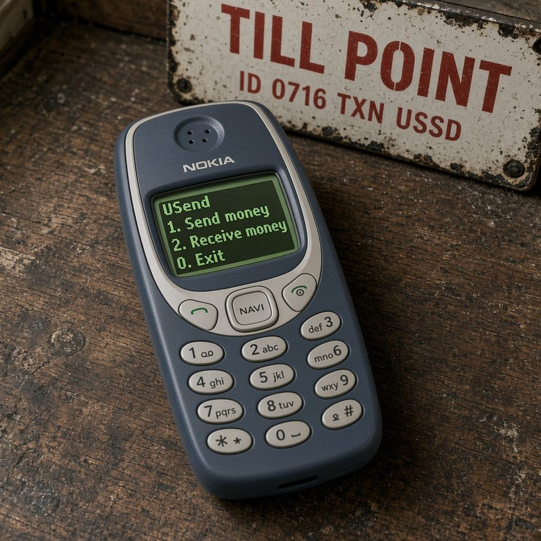
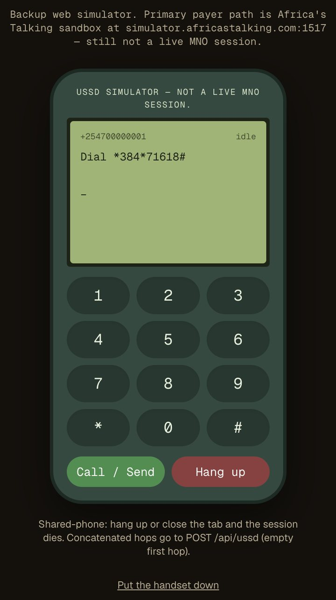

# USend

A USDT wallet you dial. The phone number holds the money.



No app. No internet on the handset. No smartphone. Dial `*384*71618#`, set a PIN, and this number can send and receive prize USDT. A feature phone cannot type a chain address, so you pay another phone number. A short code exists only when you would rather not share the number. USend holds the keys and pays the gas. Whitechain settles the token.

This dial is the Africa’s Talking sandbox, not Safaricom or Airtel.

[Open USend](https://isp-womens-clan-floppy.trycloudflare.com) · [Dial *384*71618#](https://simulator.africastalking.com:1517/)

The pitch is in [docs/PITCH.md](docs/PITCH.md).

## The session

The photograph is a product still. Its screen is not the live menu.

A number that has never dialed does not have a wallet yet. The first session asks for a 4-digit PIN, then asks you to confirm it. When the two match, the wallet opens and the screen shows the number, the short code, and the balance. Until that happens, nobody can pay this number.

After the wallet exists, the session is:

```
USend
1. Send
2. Receive
3. Balance
0. Exit
```

| You press | What you get |
| --- | --- |
| `1` | Their phone number, then the amount, then your PIN. A 6-digit code still works. Success reads `Confirmed. {amount} sent to {number}.` |
| `2` | `People pay this number`, then the number and the short code. |
| `3` | Your code and balance. |
| `0` | `Thank you.` The session ends. Hanging up does the same. |

Before the PIN, the screen says `Fee: 0. No extra charge.`

An unknown number, your own number, a bad amount, a short balance, or a wrong PIN ends with `You were not charged.` Three wrong PINs lock that session.



The keypad on the homepage talks to the same `POST /api/ussd`. The dial to use in the sandbox is the [Africa’s Talking simulator](https://simulator.africastalking.com:1517/). Register the phone, launch USSD, and type `*384*71618#`. `*384#` alone does not open USend.

## Two phones you can use now

| Phone | Code | PIN |
| --- | --- | --- |
| `+254700000001` | `880001` | `2580` |
| `+254700000002` | `880002` | `2580` |

The PIN is not printed on the handset. Type the other number with the country code, `254700000002`, not a leading `0`.

To send from the first phone: `1` → `254700000002` → an amount → `2580`. On the other phone, press `3` to see the balance, or `2` to see the number people should pay.

A new number gets a wallet only after it dials and sets its own PIN. The address is not computed from the digits of the phone. The phone is a row in the directory, written at that moment.

## The money

Prize USDT on Whitechain Sepolia. One send is at most 100. The payment stays open for 15 minutes. USend’s relayer pays the network fee, so the phone’s balance is only the stablecoin.

This is not a cash-out. There is no refund in this version. Paying the other token, USDT.e, does not count.

## A shared phone

Hang up, or close the keypad, and the session is gone. The next person does not continue your PIN entry.

The callback and the operator routes are in [docs/API.md](docs/API.md).
